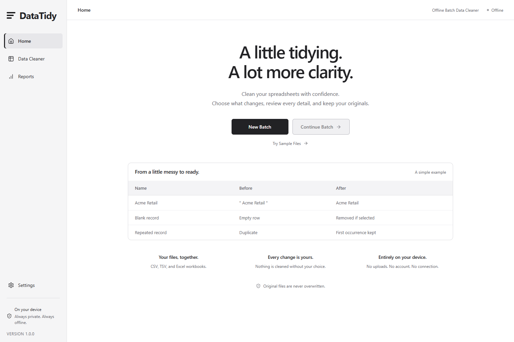
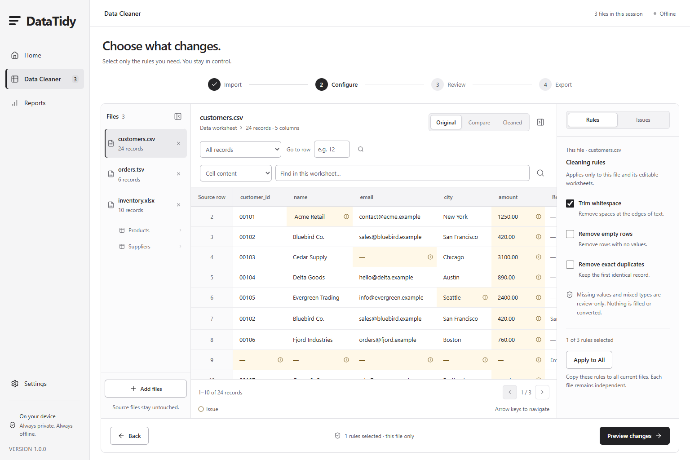
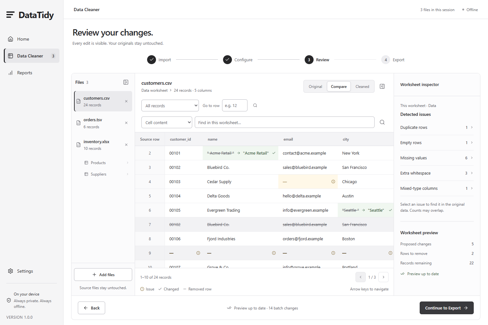
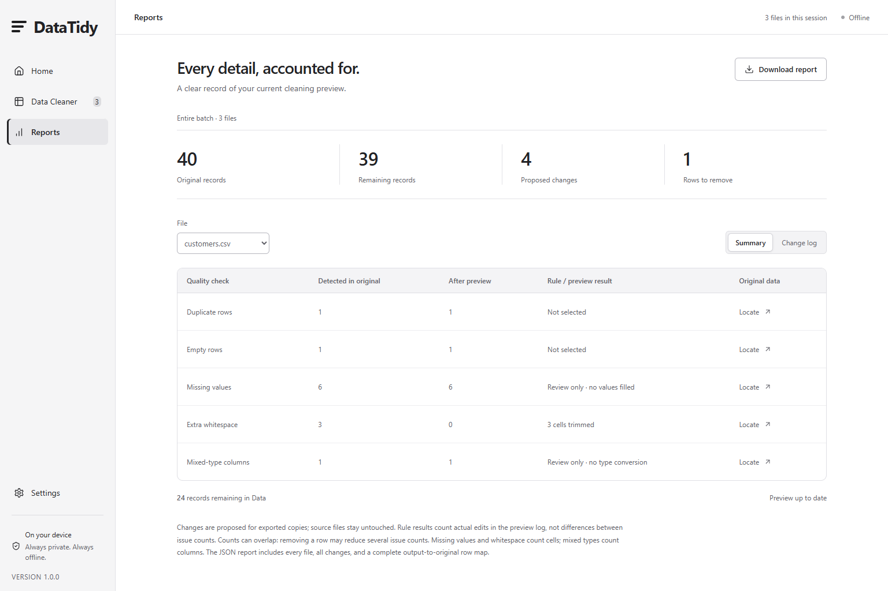
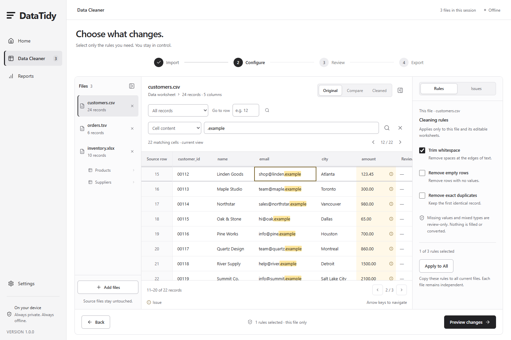
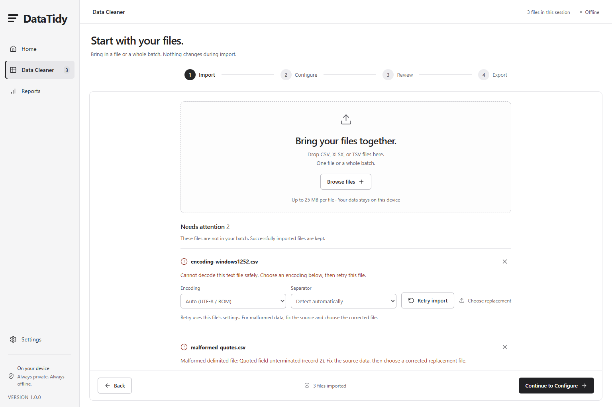

# DataTidy — Offline Batch Data Cleaner

A polished, private desktop workspace for cleaning CSV, TSV, and Excel files, with four pages and a guided Import → Configure → Review → Export workflow. Import a batch, choose exactly what to change, inspect the comparison, and export new copies. No installation, account, API key, server, or internet connection is needed during use.

**Version 1.0.0 · Portable HTML application · Tested in desktop Chrome and Edge**

## Key features

- Import several CSV, TSV, and XLSX files together, including workbooks with multiple worksheets.
- Detect duplicate and empty records, missing values, extra whitespace, and inconsistent apparent types.
- Choose independent cleaning rules for each file, or explicitly copy a selection with **Apply to All**.
- Search cell contents, column names, and original row numbers, with highlighted matches and direct navigation.
- Compare original and proposed values before exporting; keep original row references throughout.
- Download individual cleaned files, a batch ZIP, and a detailed JSON quality report.
- Process everything locally, preserve source files, and block exports when the preview is outdated.

## Start in under a minute

1. If you received `DataTidy-v1.0.0.zip`, right-click it and choose **Extract All**. Open the extracted DataTidy folder.
2. **Double-click `DataTidy.html`.** In the source workspace, the application is at `release/DataTidy.html`. If it opens in a text editor, right-click → **Open with** → **Google Chrome** or **Microsoft Edge**.
3. You should see **“A little tidying. A lot more clarity.”** and an **Offline** indicator. This is the success sign: the app is running. No terminal commands are required.
4. Click **Try Sample Files** for an immediate demonstration. To use your own files, choose **New Batch**, then drag them into the Import drop area.

DataTidy is a portable desktop-friendly browser application, not a native installer. The entire runtime is bundled into one HTML file, about 0.5 MB. You can copy that file to another computer or use it with the network disconnected. Recent desktop Chrome and Edge are the tested browsers. Safari and Firefox have not been verified.

## Find your way around

- **Home** separates **New Batch** from **Continue Batch**. Continue restores the current workflow, selection, rules, search, and preview. New Batch asks before clearing existing work. **Try Sample Files** starts a sample batch and uses the same confirmation when work exists.
- **Data Cleaner** guides you through Import, Configure, Review, and Export. The numbered progress bar shows your current step; Back and the primary action stay visible at the bottom.
- **Reports** shows batch totals, per-file and per-sheet quality checks, and a paginated change log. Each detected issue or change links back to its original data.
- **Settings** contains encoding and separator preferences, reset-to-default controls, help, recovery guidance, and capacity information.

Moving between pages preserves imported files, selected worksheets, file-specific rules, retry settings, search, the current step, and the preview. New Batch clears that work only after confirmation; import preferences in Settings are retained. Continue Batch is disabled when the session has no work. The most recent file removal also counts as work so its Undo can be recovered. Preferences apply to new imports only. The session stays in memory; closing or reloading the application clears it.

## Visual guide: Home → Import → Configure → Review → Export

The images below are real screenshots of DataTidy running with networking disabled, not mockups. They show several example batches; rule selections and totals can differ between images. Keep the `docs` folder beside this README so the relative image links work in a Markdown viewer.

### 1. Home — start or resume

1. Choose **New Batch** to begin with your own files, or **Try Sample Files** to explore the included examples.
2. If work already exists, **New Batch** asks before discarding it. Cancel to keep your files, settings, and preview.
3. Choose **Continue Batch** to return to the current step without resetting anything.

**Success:** Data Cleaner opens at Import for a new batch, or at the saved workflow step for an existing batch. Continue Batch is unavailable when there is no work to resume.



### 2. Import — add your files

1. Drag CSV, TSV, or XLSX files into the drop area, or click **Browse files** and select several files.
2. Check each filename, record count, and readiness notice. Use **Settings** before importing if you need a specific encoding or separator.
3. Click **Continue to Configure**. This action is disabled until at least one file has imported successfully.

**Success:** the imported-file list shows your batch. Failed files appear separately with their own recovery options; successful files stay available.


### 3. Configure — choose changes for each file

1. Select a file or Excel worksheet in the left navigation. The center table shows its original data.
2. Choose **Rules** in the right inspector. Every newly imported file starts with all rules off. Select only the changes you want for that file and its editable worksheets.
3. Select the other files and configure them independently. Use **Apply to All** only when you want to copy the selected file's choices to all current files. **Undo Apply to All** restores their previous choices.
4. Click **Preview changes** when ready.

**Success:** the workflow moves to Review with a current preview. In this example, only **Trim whitespace** is selected for `customers.csv`.



### 4. Review — inspect before and after

1. Switch between **Original**, **Compare**, and **Cleaned**. Pale green with checkmarks identifies edits; pale amber with issue symbols identifies detected issues. Struck-through rows and removal labels identify proposed removals.
2. Select a cell to inspect its full original and proposed values. **Back to rules/issues** closes the details and restores focus to that cell.
3. Use **Issues** to locate a detected issue in the original records. Use search or **Go to row** for a specific value or source record.
4. Inspect the other files and worksheets, then click **Continue to Export**. Use **Back** to adjust the rules and generate another preview if needed.

**Success:** you can trace every proposed change to its original record. **Source row** counts the header as row 1; a quoted multiline CSV field still belongs to one logical record.



The table shows 10 records per page and scrolls horizontally and vertically. Collapse the file navigation or hide the inspector to give the table more space. Filtering issues does not change the workflow step or modify any data.

### 5. Export — download new copies

1. Choose **Entire batch** for a ZIP, or **A single file** and its filename.
2. Review the exact change and removal counts. When rows will be removed, check the acknowledgement before downloading.
3. Click **Download ZIP** or **Download file**. A batch ZIP includes the output files and a JSON quality report.

**Success:** a download-started message appears and the browser saves a new file to its configured download location. DataTidy does not overwrite your source files and cannot verify the browser's final save destination.


You can go Back to change rules or revisit an earlier completed step. Changing a rule, importing, removing, or restoring a file invalidates the preview. Review/Export stay unavailable until you generate a fresh preview. Merely switching pages, files, worksheets, or view modes does not invalidate it.

Remove a file from the session with its × button, then choose **Undo removal** to restore it. The most recent removed file and its own rules remain available for Undo across pages until another removal replaces it or the app closes. If capacity is full, re-import the removed original file in a smaller batch. Turning a cleaning rule off and previewing again reverses its proposed effects. Already downloaded files are independent copies.

## Multi-file cleaning and independent rules

Rules belong to a file and apply to all of its editable worksheets. Selecting another file displays that file's own choices. Duplicate detection stays within each worksheet; it never merges records across files or worksheets.

Try this example with **Try Sample Files**:

| File | Select these rules | Expected preview |
| --- | --- | --- |
| `customers.csv` | Trim whitespace only | 24 records remain; 3 cells trimmed |
| `orders.tsv` | Remove exact duplicates only | 5 records remain; 1 duplicate removed |
| `inventory.xlsx` | Leave all rules off | 10 records remain across two worksheets; unchanged |
| **Batch total** | Three independent selections | **39 records remain; 4 changes; 1 record removed** |

**Apply to All** is a one-time copy, not a permanent link between files. After copying, any file can be adjusted independently. **Undo Apply to All** remains available across page changes until another rule or batch change, or New Batch. New imports always start with every rule off. Applying or undoing rules invalidates the preview and disables export until a new comparison is prepared.

## Understand quality reports

In **Reports**, select a file and worksheet, then choose **Summary** or **Change log**. **Locate** and **Original** links open the exact issue or source record in Data Cleaner. Download the JSON report for all files, every change, and the complete output-to-original row mapping. Reports describe the current preview; exported downloads are not maintained as a separate history.

**Detected issues and performed changes are different measures.** The **Rule / preview result** column shows Not selected, Selected · preview required, Selected · no matching changes, actual trimmed-cell/removed-row counts, or Protected · unchanged. Missing-value and mixed-type checks remain review-only. Changes are counted from the change log, never inferred by subtracting issue totals: deleting one empty row can reduce several detected issue counts without filling any cells.



JSON and ZIP reports contain per-file `requestedRules`, preview `rules`, per-sheet `appliedRules`, exact `actions` counts, and `previewCurrent`. A report without a current preview has `state: "analysis"`, zero applied rules, and unchanged records even if rules are selected. Protected worksheets always have zero applied rules. Batch ZIP reports have `state: "export"` and retain unique output filenames. `excludedImports` lists unresolved failed imports; these files are never silently included as cleaned data.

## Find data quickly

1. Open a file and worksheet in Configure or Review. Choose **Cell content**, **Column name**, or **Original row number** above the table.
2. Type a query and press **Enter** or click **Search worksheet**. Text searches are literal and case-insensitive; special characters are not regular expressions. Success: matching text is highlighted and the result count appears.
3. Use **Previous match / Next match** to jump directly to a matching cell or column, including results beyond the visible page. Matching cells count once even when the same text occurs twice in a cell. Column-name searches highlight matching headers while retaining the records for context.
4. **Original row number** takes an exact integer and switches to Original, so a removed record can be inspected. Source references include the header as row 1. The existing **Go to row** control bypasses filters and search when you need an exact source record.
5. Choose **Clear search** to restore the unsearched view. Search is scoped to the selected worksheet and current issue filter. Original searches source values; Compare searches original and proposed values; Cleaned searches surviving output values. Switching pages keeps the query; selecting a different file or worksheet resets it. No matches is a valid empty view with a recovery action.



## Recover failed imports

1. In **Import → Needs attention**, find the failed filename and its explanation. Successfully imported files and their rules remain available.
2. For text files, choose that entry's **Encoding** and, for CSV, **Separator**, then click **Retry import**. The stored file is retried without requiring another file-picker selection. These options belong to this failed file, independently of Settings defaults and other failures.
3. For malformed data, repair a copy in your editor and choose **Choose replacement** to select it. Success: the failed entry disappears, the file joins the batch once, and its rules start off. Another failure updates the same entry without creating a duplicate.
4. Use the entry's × button to dismiss a failed import. Retrying unsuccessfully does not invalidate an existing preview; a successful import does. Export warns about unresolved failures, and JSON/ZIP reports list excluded filenames and errors.



## Keyboard access and readability

- Press **Tab** to move between controls. The first link, **Skip to content**, bypasses the main navigation. Page and workflow changes focus the new heading.
- The preview has one keyboard entry point. Use **arrow keys** to move between visible cells, **Home / End** within a row, and **Control / Command + Home / End** across the current page. Use the pagination controls for other pages.
- Press **Enter** to inspect a cell or activate an original-row link. Press **Escape** to close cell details and return focus to the selected cell. **Tab** leaves the table.
- View, report, and inspector segmented controls support **Left / Right**, **Home**, and **End**.
- Use your browser's zoom controls to enlarge the interface. Panes stack when needed; data tables scroll in both directions. Reduced-motion and high-contrast preferences are respected. All fonts and icons are local.

The design uses shared type, spacing, color, and control tokens. It was audited against Apple's official HIG and documented Numbers/Finder interaction patterns. See the [UI audit and design rationale](docs/ui-audit.md) for the specific problems, source links, before/after measurements, and verification limits. Manual screen-reader testing has not been performed.

## Cleaning rules and their exact meaning

| Rule or check | Behavior |
| --- | --- |
| Trim whitespace | Removes leading and trailing Unicode whitespace from text cells. Internal spacing, letter case, headers, numbers, and formulas are untouched. Excel rich-text cells are not edited. |
| Remove empty rows | Removes records whose fields are all empty or whitespace-only. Formula and other protected cells do not count as empty. |
| Remove exact duplicates | Compares the complete original record, including Excel cell types; keeps the first occurrence. Matching occurs **before trimming**, so near-duplicates are never silently merged. Entirely empty records belong to the separate empty-row rule. |
| Missing values | Flags empty cells and missing fields. Does not invent, interpolate, fill, or remove values. Whitespace-only text is reported as whitespace until trimmed. |
| Inconsistent types | Flags columns containing multiple apparent types: number, boolean, date-like text, or text. This is a heuristic for review, not a schema validator. IDs with leading zeros remain text. No types are converted. |

Issue counts can overlap. Missing values and whitespace count **cells**; duplicates and empty rows count **records**; mixed types count **columns**. A mixed-type column highlights its nonempty values so you can review the whole column. “Changes” counts individual trimmed cells plus removed rows. Trims on a removed row are not counted separately. Removing records can reduce multiple issue counts at once.

## Supported formats and integrity

| Format | Supported behavior |
| --- | --- |
| CSV | Comma, semicolon, tab, and pipe separators; automatic detection or an explicit setting; quoted delimiters and multiline fields; UTF-8, Windows-1252, UTF-16 LE/BE. |
| TSV | Tab-separated records, including quoted tabs and multiline fields; the same text encodings as CSV. |
| XLSX | Standard OOXML workbooks, multiple worksheets, hidden sheets, shared/inline strings, numeric and boolean cells. Simple tabular sheets can be cleaned. Advanced workbooks remain available for inspection and byte-identical original-copy export. |

Text files use UTF-8 unless a UTF-8/UTF-16 byte-order mark identifies their encoding or you choose an explicit encoding. A failed UTF-8 decode is rejected, not replaced with garbled characters. Choose Windows-1252 or the correct UTF-16 variant in the failed entry and click **Retry import**. Settings defaults apply to future imports. Separator inference can be ambiguous; if a preview has the wrong columns, remove it, choose an explicit separator, and re-import.

The source files are read-only inputs. No file-system write access is requested. Header values, duplicate/blank header names, column order, leading-zero strings, large integer strings, and original cell contents are preserved unless covered by a selected rule. Uneven CSV row widths are flagged and preserved, including extra fields. No deduplication occurs across files or sheets.

**Unchanged exports are byte-identical to the original file.** Changed text exports preserve the selected/detected encoding, BOM presence, separator, line-ending convention, and final-newline presence. CSV quoting may be normalized while cell values remain the same. Files with mixed line-ending styles are normalized to the detected line-ending convention when changed.

For editable Excel workbooks, changes are made to worksheet XML inside the original archive. Other archive entries, cell styles, numeric representations, and worksheet names are retained. Removed rows are compacted and remaining cell addresses are updated; the quality report records the original positions. The preview shows stored Excel values rather than full Excel formatting: dates stored numerically appear as serial numbers. Formatting is retained in the exported workbook. Formulas are displayed as expressions and are never calculated.

**Excel protection policy:** workbooks with formulas, defined names, tables, pivot tables, merged cells, drawings, comments, links, conditional formatting, validation, protection, signatures, or other recognized dependent structures are inspection-only. Cleaning is disabled for the entire workbook to avoid damaging references. These files remain in a batch ZIP as unchanged copies, with the reason in the report. Password-protected/encrypted workbooks, legacy `.xls`, `.xlsm`, and damaged archives are not supported. DataTidy is intended for ordinary tables, not arbitrary Excel document editing.

CSV cells beginning with formula-like characters remain unchanged. Spreadsheet programs may interpret them as formulas when you open the export; DataTidy itself treats them as text and does not evaluate them.

## Privacy, capacity, and errors

All parsing, checking, cleaning, and ZIP creation occur in a local background Web Worker. Fonts, icons, libraries, sample data, and worker code are embedded in the HTML. There are no remote resources, analytics, uploads, accounts, or persistence. A Content Security Policy disables outgoing connections. Reports contain source values and should be handled with the same care as the datasets.

Practical limits are deliberately bounded for a lightweight first release:

- 25 MB per input file; 100 MB of source files per batch; 25 files per batch.
- 100,000 data records per worksheet; 512 columns; 1,000,000 cells per file.
- 100 MB of declared uncompressed Excel archive content and 3,000 archive entries.
- Data is held in memory, not streamed to disk. Available memory and wide or complex data can impose lower practical limits. Split oversized datasets into smaller batches.

Malformed quotes, unsupported formats, encoding problems, and invalid workbook references produce an English error with next steps. A failed import does not discard the other files. A short file with an ambiguous separator is flagged for review. If the worker stops or a processing request times out after two minutes, reload and try a smaller batch. There is no silent partial export.

## Sample datasets

All names and contacts are fictional. `.example` email domains are reserved examples.

| File | What to test |
| --- | --- |
| `samples/customers.csv` | 24 customer records; leading-zero IDs; 1 exact duplicate, 1 empty record, 3 whitespace cells, missing email, and a mixed amount column. All three rules on this file yield **22 records and 5 changes**. Trim alone keeps **24 records with 3 changes**. |
| `samples/orders.tsv` | Orders with a duplicate, a missing note, an empty record, mixed quantities, and a quoted multiline note. Duplicate removal alone keeps **5 records with 1 change**. |
| `samples/inventory.xlsx` | Two worksheets, numeric stock values, whitespace, duplicate rows, and missing values. All rules yield **4 Products records and 3 Suppliers records**. |
| `samples/encoding-windows1252.csv` | Accented names. Auto UTF-8 rejects it; selecting Windows-1252 allows accurate import and export. |
| `samples/malformed-quotes.csv` | Deliberately unclosed quotes. The correct result is a clear import error. |
| `samples/protected-formulas.xlsx` | A formula-containing workbook. The correct result is an inspection-only notice and an unchanged export. |

## More interface examples

The visual guide uses screenshots captured at 1536 × 1024. Additional real application views are available here: [Continue Batch](docs/16-continue-batch.png), [New Batch confirmation](docs/17-new-batch-confirmation.png), [Settings and help](docs/06-settings.png), [change log](docs/07-change-log.png), [cell details](docs/11-cell-details.png), [compact desktop](docs/09-compact-desktop.png), [mobile search](docs/21-search-mobile.png), [200% text](docs/12-large-text.png), [compact zoom layout](docs/13-zoom-layout.png), and [forced colors](docs/14-high-contrast.png).

## Development and verification (optional)

End users do **not** need Node.js or these commands. The source is included for maintainers. Development installs download third-party packages; runtime does not use the internet. Build/test commands write generated application, sample, and screenshot files inside this project.

With Node.js 24+ installed, open a terminal in the source directory and run:

```powershell
npm ci
npm run samples
npm test
npm run build
npm run test:ui
npm run test:design
npm run test:refinements
```

Success signs: the engine suite prints all tests passing; the build prints the path `release/DataTidy.html`; UI tests print `PASS` after testing the actual standalone file with networking disabled. UI tests require an installed Chrome browser and permission for the browser to save local downloads. Set `BROWSER_CHANNEL=msedge` in the environment to use installed Edge instead.

The 24 engine and worker tests cover all five issue classes, independent rule selection, original immutability, byte-identical no-op output, leading zeros, multiline and uneven CSV, delimiters, BOMs, encodings, malformed input, workbook sheets, shared/rich strings, formula protection, ZIP name collisions and reports, and a 100,000-record dataset. The refinement suite separately verifies New/Continue and discard confirmation, three different CSV/TSV/XLSX rule sets, reversible Apply to All, actual export contents, file-specific report labels and JSON fields, literal/Unicode/column/source-row searches with cross-page navigation, no-match recovery, retained search, failed retries without duplicates, per-file encoding recovery, corrected-file replacement, reset semantics, and mobile search. Browser tests cover the complete four-step flow, all main pages, file picker and drag/drop, state retention, rules, comparisons, issue-to-original navigation, cell details, change logs, collapsed navigation, undo removal, stale-preview blocking, removal acknowledgement, worksheet selection, actual ZIP/single/report downloads, error recovery, and zero HTTP requests or console errors. Layout checks cover 1536 × 1024, 1280 × 720, and 390 × 844, including the always-visible workflow footer. The design regression suite additionally checks measured text contrast, keyboard table and segmented-control navigation, skip links, focus return, Configure-stage stability, 200% text, visible data at a 768 × 512 zoom-equivalent viewport, reduced motion, and forced-color rendering. The workflow suite checks that changing export scope clears previous download feedback. The suite also verifies the original engine SHA-256 so UI work cannot silently change cleaning behavior. Exported Excel files are also checked with the independent Python `openpyxl` library during release verification.

Architecture: the unchanged `src/core.mjs` contains parsing, analysis, plans, and export. `src/worker.mjs` owns documents, per-file rules, and current plans, and responds to paginated table, search, issue-location, change-log, reset, and undo requests. `src/search.mjs` performs read-only worksheet search; `src/reporting.mjs` derives truthful action labels and counts from changes. `ImportErrors.jsx` and `DataSearch.jsx` extend the existing React workspace. `src/session.js` owns the session state above all pages. The existing React UI has been refactored into `Sidebar.jsx`, `Preview.jsx`, `RulesPanel.jsx`, `pages.jsx`, shared `ui.jsx` primitives, and the workflow shell in `main.jsx`. `src/style.css` defines the responsive design; `scripts/build.mjs` uses esbuild to embed everything into one HTML. Core library references: [Papa Parse documentation](https://www.papaparse.com/docs), [JSZip documentation](https://stuk.github.io/jszip/documentation/api_jszip.html). These documentation links are optional and never loaded by the app.

`npm run package` creates the portable ZIP with the ready application, README, screenshots, samples, source, lockfile, and third-party notices. The built application can be distributed on its own; keep the notices alongside it when redistributing.

The redesign follows the structural patterns in Apple’s [sidebar](https://developer.apple.com/design/human-interface-guidelines/sidebars) and [toolbar](https://developer.apple.com/design/human-interface-guidelines/toolbars) guidance: stable main navigation, separate file/worksheet navigation, contextual controls, and a clear primary action. It remains a portable browser application, not a native macOS application. All data processing remains local. Sharing the development conversation separately through AgentGit does not add an upload feature to DataTidy.


## Refinement verification

The standalone `file:` application was tested in installed Chrome and Edge with networking disabled. Browser plugin not available; the existing Playwright suites were used. No server or additional runtime dependency was introduced.

| Check | Result |
| --- | --- |
| Page identity, meaningful rendering, no framework error overlay | Passed on Home, Data Cleaner, Reports, and Settings |
| Runtime console and HTTP requests | Zero errors and zero HTTP requests |
| Original processing engine | SHA-256 unchanged; all 16 original tests passed |
| Worker and session behavior | 8 additional tests passed, including 100,000-row search and independent file exports |
| Complete interaction | Home → Configure different rules → Search → Review → Reports → Export → Retry → New Batch passed |
| Data integrity | Exact exported CSV/TSV counts and values, unchanged XLSX bytes, ZIP CRC and unique names, independent openpyxl verification passed |
| Keyboard and responsive layout | Passed at desktop, compact desktop, mobile, 200% text, and 768 × 512 zoom-equivalent viewport |

The current interface, local worker architecture, double-click launcher, and English content are preserved. Session state remains memory-only; closing or reloading clears it. Safari, Firefox, native macOS execution, and manual VoiceOver/NVDA interaction remain unverified. The illustrated documentation update does not change application behavior; the results above describe the existing application verification.
